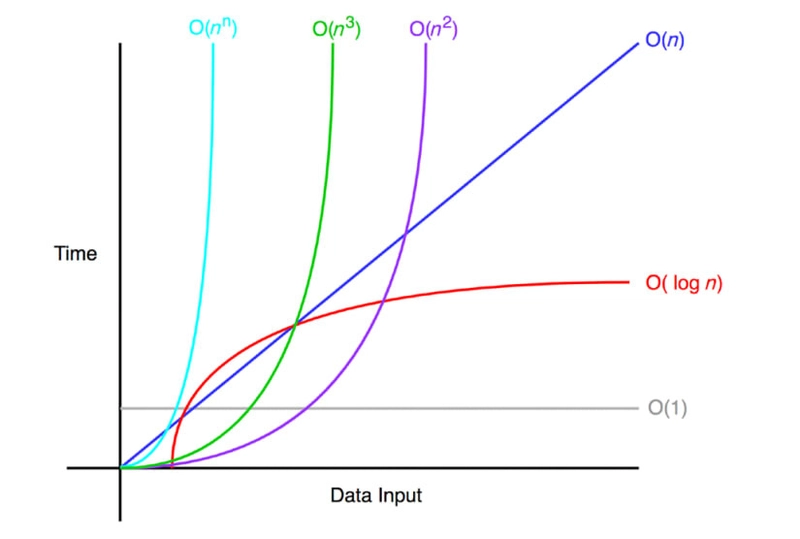

# Grokking_Algorithms

Repository for the book Grokking Algorithms

## Chapter 1

Algotithm: is a set of instructions for completing a task

##### Binary search

- binary searches input is a sorted list of elements
- binary search eliminates half the list with each guess, if you want to guess a number between 1-100, with binary search you can guess it with a maximum of 7 guesses.

100 --> 50 --> 25 --> 13 --> 7 --> 4 --> 2 --> 1  (7 guesses)

- Supposes you are looking for a word in a dictionary if 240000 words

Worst case: with simple search you are looking for the last word in the dictionary and it will take you 240000 guesses to get the word

with Binary search (worst case): 240000 --> 120000 --> 60000 --> 30000 --> 15000 --> 7500 --> 3750 --> 1875 --> 938 --> 469 --> 235 --> 118 --> 59 --> 30 --> 15 --> 8 --> 4 --> 2 --> 1
(19 guesses)

simple search : n steps
Binary search: log n steps

check [binary_search.py](binary_search.py) for how to do it in python

| Items          | simple search     | Binary search|
| ---------------| ----------------- | -------------|
| 100 item       | 100 guess         | 7 guesses    |
| 4 billion items| 4 billion guesses | 32 guess     |
 

#### Big O worst case scenarios as n inceases

 
 
 

# Chapter 2
