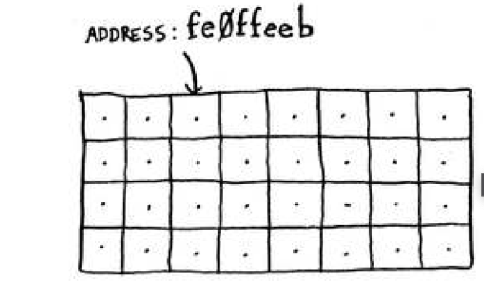

# Grokking_Algorithms

Repository for the book Grokking Algorithms

## Chapter 1

Algotithm: is a set of instructions for completing a task

##### Binary search

- binary searches input is a sorted list of elements
- binary search eliminates half the list with each guess, if you want to guess a number between 1-100, with binary search you can guess it with a maximum of 7 guesses.

100 --> 50 --> 25 --> 13 --> 7 --> 4 --> 2 --> 1  (7 guesses)

- Supposes you are looking for a word in a dictionary if 240000 words

Worst case: with simple search you are looking for the last word in the dictionary and it will take you 240000 guesses to get the word

with Binary search (worst case): 240000 --> 120000 --> 60000 --> 30000 --> 15000 --> 7500 --> 3750 --> 1875 --> 938 --> 469 --> 235 --> 118 --> 59 --> 30 --> 15 --> 8 --> 4 --> 2 --> 1
(19 guesses)

simple search : n steps
Binary search: log n steps

check [binary_search.py](binary_search.py) for how to do it in python

| Items          | simple search     | Binary search|
| ---------------| ----------------- | -------------|
| 100 item       | 100 guess         | 7 guesses    |
| 4 billion items| 4 billion guesses | 32 guess     |
 

#### Big O worst case scenarios as n inceases

 
 
 

## Chapter 2

How the memory actualy works ?
- The memory on your computer is like a set of drawers, and each drawer has an address
 
 

 
  
- fe0ffeab is the address for that slot in memory
- Each time you want to store an item in memory you ask your computer for space and it gives you the address of where to store the item,
if you want to store multiple items there is ways to do so

#### Arrays and Linked lists

Suppose you want to store elements of to do list in memory, should you use an array or a linked list?

Array : means all your tasks are stored continously (next to each other)

- Suppose you go to the cinema and book seats with 4 of your friends, and 1 other friend decides to join, if the seat next to you is occupied you will have to move to a new place that fit all 6 of you

- you can ask the computer for a new bigger chunk of memory which you may never use.

Linked list: in a linked list you can store items anywhere in memory. with each item storing the address for the next item in the list, a bunch of random adrreses are linked together

- first address saves the address for the second addrees and secode saves address for third and so on
- Problem: if you want to read the last item in a list you have to pass all itens to get to it
- Linked lists are great if you want to read all items at one but are terrible if you want to jump around

Arrays are different you know the address for an item on the array, for example suppose the array has 5 item and the first item is at 00 where will the 5th item be: 04

|Action | Array | Lists |
|------|-------|--------|
|Reading| o(1)| o(n)|
|insertion | 0(n)| o(1)|
|deletion |o(n)| o(1)

- Inserting in the middle of the list is easy as you only need to change the address of the previous

- for arrays you have to shift the elements down or up, and if there is no space you have to find a new location

* Deletion
- If you want to delete an element in a linked list it's simple you just have to chenge where the previous element points to
- In an array every element has to shift up, However unlike insertion, it will always work (you never have to change its place in memory as minusing an element is different to adding one)

arrays = standard access. lists = sequential access

[simple sorting algorithm]()

