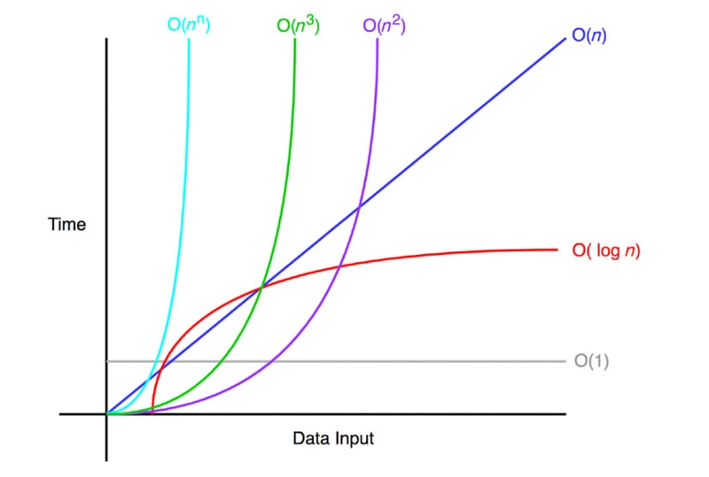
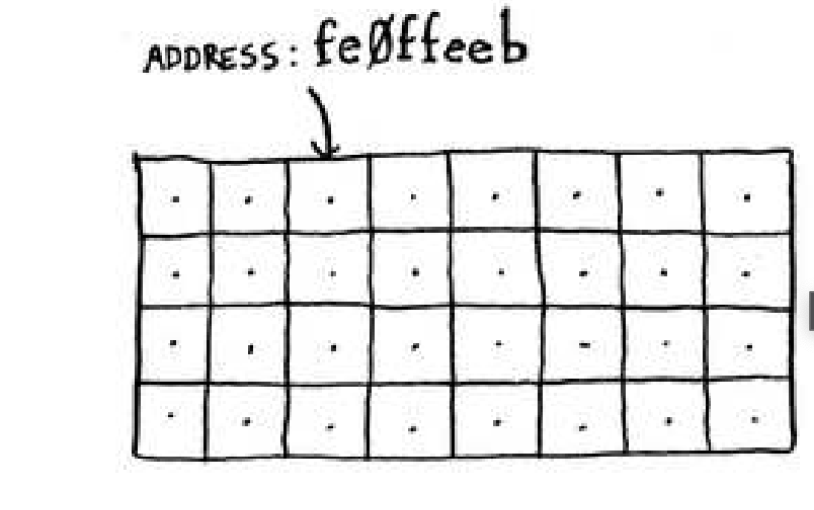

# Grokking_Algorithms

Repository for the book Grokking Algorithms

## Chapter 1

Algotithm: is a set of instructions for completing a task

##### Binary search

- binary searches input is a sorted list of elements
- binary search eliminates half the list with each guess, if you want to guess a number between 1-100, with binary search you can guess it with a maximum of 7 guesses.

100 --> 50 --> 25 --> 13 --> 7 --> 4 --> 2 --> 1  (7 guesses)

- Supposes you are looking for a word in a dictionary if 240000 words

Worst case: with simple search you are looking for the last word in the dictionary and it will take you 240000 guesses to get the word

with Binary search (worst case): 240000 --> 120000 --> 60000 --> 30000 --> 15000 --> 7500 --> 3750 --> 1875 --> 938 --> 469 --> 235 --> 118 --> 59 --> 30 --> 15 --> 8 --> 4 --> 2 --> 1
(19 guesses)


simple search : n steps
Binary search: log n steps

check [binary_search.py](binary_search.py) for how to do it in python


| Items          | simple search     | Binary search|
| ---------------| ----------------- | -------------|
| 100 item       | 100 guess         | 7 guesses    |
| 4 billion items| 4 billion guesses | 32 guess     |
<br>

#### Big O worst case scenarios as n inceases


<br>
<br>
<br>

## Chapter 2

How the memory actualy works ?
- The memory on your computer is like a set of drawers, and each drawer has an address
<br>
<br>

<br>
<br> 
- fe0ffeab is the address for that slot in memory
- Each time you want to store an item in memory you ask your computer for space and it gives you the address of where to store the item,
if you want to store multiple items there is ways to do so

#### Arrays and Linked lists

Suppose you want to store elements of to do list in memory, should you use an array or a linked list?

Array : means all your tasks are stored continously (next to each other)

- Suppose you go to the cinema and book seats with 4 of your friends, and 1 other friend decides to join, if the seat next to you is occupied you will have to move to a new place that fit all 6 of you

- you can ask the computer for a new bigger chunk of memory which you may never use.

Linked list: in a linked list you can store items anywhere in memory. with each item storing the address for the next item in the list, a bunch of random adrreses are linked together

- first address saves the address for the second addrees and secode saves address for third and so on
- Problem: if you want to read the last item in a list you have to pass all itens to get to it
- Linked lists are great if you want to read all items at one but are terrible if you want to jump around

Arrays are different you know the address for an item on the array, for example suppose the array has 5 item and the first item is at 00 where will the 5th item be: 04


|Action | Array | Lists |
|------|-------|--------|
|Reading| o(1)| o(n)|
|insertion | 0(n)| o(1)|
|deletion |o(n)| o(1)

- Inserting in the middle of the list is easy as you only need to change the address of the previous

- for arrays you have to shift the elements down or up, and if there is no space you have to find a new location

* Deletion
- If you want to delete an element in a linked list it's simple you just have to chenge where the previous element points to
- In an array every element has to shift up, However unlike insertion, it will always work (you never have to change its place in memory as minusing an element is different to adding one)

arrays = standard access. lists = sequential access

[simple sorting algorithm]()

## Chapter 3 

Recurrsion: is when you call a function inside itself

```python
def look_for_key(box):
    for item in box:
        if item.is_a_box():
            look_for_key()
        elif item_is_key():
            print("Found Key")
```
###### Base case and recursive case
- because a function calls itself it can be easy to hit an infinite loop
  
```python
def countdown(i):
    print(i)
    countdown(i-1)
```
When you write a function you have to tell it when to stop recursing the base case does that 
- the base case is when the function doesnt call itself again after it

```python
def countdown (i):
    print (i)
    if i <= 0: #Base case
        return
    else:
        countdown(i-1)
```
#### The Stack

- when you insert an item it gets added to the top of the list and when you read an item it reads from the top of the list
- push: add item to the top     pop: read item from the top

###### The call stack

```python
def greet(name):
    print(f"hello {name}")
    greet2(name)
    print(getting ready to say goodbye)
    bye()
```
- This function greets you and calls two other functions

Lets go through what happens when you call a function greet("Perla")
 
 - your computer allocates a memory for the function call
 - use the memory to set variable name to equal to "Perla" and saves it in memory
 - Next you print hello perla then call the function greet2 again your computer alocates a memory for this function call it stores information for greet2 on top of greet
 - Next you print how are you perla and then return from the function call, when this happens the box on top of the stack (greet2) gets poped off
 
The idea is when you call a function inside a function, the calling function is paused in a partialy complete state All the variables and values from the function are still stored in memory

## Chapter 4

when you face a new problem you ask yourself can I Devide and conquer (D&C)

#### Devide and conquer 

##### Example 1 
you have a land 1680 by 640 you want to devide it to square plot and want to figure out what the largerset square you can use

- Use devide and conquer strategy, D&C algorithms are reccursive algorithms

To solve using devide and conquer you need two steps:
- Figure the base case which is the simplest possible case 
- devide and decrease until it reaches the base case

The base case for the example is when on side of the square is a multiple of the other side 
Reccursive case: you can fit two boxes of 640x640 in the 1680x640 land

- then you are left by a land 640x400
- you can fit 400x400 and you are left by land of 400x240
- you can fir 240x240 and is left by 160x240
- you can fit a 160x160 and is left by 160x80 (Base case as the 160 is a multiple of 80 so when devided by 2 80x80 and 80x80)

so the largest square plot you can use us 80x80

Euclid threorm

##### Example 2

you are given an array of integers [2, 4, 6]

you have to add up all the elemnts of the array

check [array_sum.py](array_sum.py)

But how would you do it in a reccursive function
- Step 1 (base case): if array is empty return 0
- step 2: if not you need to move closer to an empty array
[reccursive_sum.py](reccursive_sum.py)


#### Quicksort
Quicksort is a sorting algorithm much faster the selection sort

simplest array to sort: empty arrays and arrays with one element (Base case)

```python
def Quicksort(arr):
    if len(arr) < 2:
        return arr
```
if the array is bigger ex: 2 elements
[1, 7]

checks if first is greater than second if yes swap them

if the array is 3 elements
[33, 15, 10]

- pick a pivot (any element in the array)
- find the elemennts smaller than the pivot and the elements larger thna the pivot and place them on each side of the pivot
- now you have 1- sub-array of elements smaller than the pivot 2- pivot 3- sub-array of elements larger than the pivot

[15, 10] + [33] + []

quicksort[15, 10] using earlier method for arrays of 2 elements

[10, 15] + [33] + [] ==> [10, 15, 33]

#### Inductive proofs
inductive proofs are one way to prove your algorithm works, each inductive proof has two steps the inductive case and base case

by proving that quicksort works in the base case (lists with 0 or 1 elements) in the inductive case you prove that it works for lists of size 2 and if it works for lists with size 2 it works for lists with size 3 and so on


#### Revisting Big(O) notation

suppose the computer does 10 operation per second

| Array Size | o(log n) | o(n) | o(nlog n) | o(n<sup>2</sup>) | o(n!)|
| -----------|----------|------|-----------|------------------|------|
|       10 | 0.3s| 1s| 3.3s|10s| 4.2days
|100| 0.6s| 10s| 66.4s| 166min  | 2.4* 10<sup>144</sup> years|
|1000 | 1s | 100s| 996s | 27.7h| 1.27* 10<sup>3559</sup> years|


Quicksort is tricky as it depends on how good the pivots are 
- Worst csse scenario: o(n!)
- Average case scenario: o(nlogn)

mergesort always has a BigO of o(nlogn)

#### Mergesort vs quicksort
suppose you have an algotithm that prints each element in a list

```python
def print_item(arr):
    for i in arr:
      print i
```
Now suppose you change this function to sleeo 1 second between before it prints

```python
from time import sleep
def print_item2(arr):
    for item in arr:
        sleep(1)
        print(item)
```
both function loop through the list once so both o(n) but in practice the first one is faster than second one

when the bigO is o(n) what it really means is c * n where c is a constant of a fixed amount of time 

usualy we ignore constants because if the bigO is different the constant doesn't really matter 

take Binary search vs simple search for example 

- if simple search does an operation in 10 miliseconds 
- and binary search does an operation in 1 second

you might think wow simple search is faster
but remember 
- Big O for simple search is o(n) --> c * n
- Big O for binary searcj is o(logn) --> c * logn

Now suppose we have a list of 4 billion elements

- Simple Search = 10 miliseconds * 4 billion = 463 days
- Binary search = 1 secons * log4billion
-                = 1 * 32 = 32 seconds

But sometimes constants do make a difference for example both mergesort and quicksort has o (nlogn) but quicksorts constant is lower so it is faster


Worst case for quicksort
- if elements are already sorted and you take the first element

[1, 2, 3, 4, 5, 6, 7, 8]
{1}[2, 3, 4, 5, 6, 7, 8]
    {2}[3, 4, 5, ,6 ,7 ,8]

and so on n times
each time there is there is o(n-1) number of operation  to split to the left and right side of the pivot and you so that n times

So o(n!)

Average case: you split them in the middle 

so the stack builds logn times and each time o(n) operations

So o(nlogn)


## Chapter 5 (Hash Tables)

suppose your a store owner and want to store the price of values of each item in an array, if you use binary search to look up each item's price it will o(logn) but there is a way to look it up in o(1) time

#### Hash Functions
a hash function maps a string to a number
"Namaste" --> 7
"hola" --> 4

Requirements of a Hash Function 
- consistant mapping: each time you write "apple" you get the same answer '4'
- it should map different words to different numbers

#### How is that useful

suppose you have an array of 5 blocks  0-1-2-3-4

you store apple in the 3rd index

milk in the 0 index

now you don't need to search for apple in the array just enter "apple" in your hash function and it will return where it is stored

#### This works because
- The hash function consistently maps the key string to the same index
- The hash function maps different strings to different indexes
- hash function know the length of the array and will only return valid indexes

Hash table = Hash function + array

you will never need to implement a hash table yourself all programming languages have a built in hash in python its {} or dict()


#### Use cases 
1- Using Hash tables for look-ups
- storing contact information each name has a phone number associated with it

2- Hash tables are used for look-ups at a larger scale
- suppose you want to go to website http:/google.com
- your computer has to transelate it to an IP address
- google.com --> 74.125.239.133
- the proccess of mapping web addresses to ip addresses is called DNS resolution

#### prventing duplicate entry
suppose you are running a voting booth, naturaly every person can vote just once, how do you make sure of that?

using a hash table

how it works

Person comes in to vote --> check if person is in hash --> if yes: Kick them out
--> if no: let them vote, add their name to hash

[hash.py](hash.py) to see how it works

#### Using a hash table as cache
suppose you want to visit Facebook.com
- you make a request to facebook's server
- server thinks for a second and comes web page to send to you
- you get the webpage

Facebook servers have millions of people the couple of seconds adds up to them, is there a way to make the server do less work and become faster?

suppose you have a niece that keeps asking you about planets, how far is the moon? how big is jupiter? Each time you get asked you have to google it and it takes time, but now suppose she keeps asking you how far is the moon? eventualy you will memorize the answer and no longer have to google it. this is what cachinhg is, websites remember the data instead of recaculating it

you --> if logged in --> webpage
you --> if not logged in --> recaculating --> webpage

[cache.py](cache.py)

#### Caching has two advantages
- You get the webpage faster
- facebook servers has to do less work

All the caching and the data is done in a hash

Facebook isn't just caching its home page it also caches its about, contract ...

facebook.com/about --> data for the about page
facebook.com --> data for the home page

when you request a URL if it's hashed you get the data from the hash, if not the server does some work and sends you the data

#### Collisions 

suppose you have an array with 26 slots, and you want to store the price of fruits in each, you chose to do it in based on the alphabitical order of the first character
- apple goes in the first slot: 0.67
- Banana goes in the second slot: 0.81
- but now you want to store an avacado, where does it go?

this is called a colision (when two keys are asssigned the same slot)

the simplest way to deal with this is to make a linked list inside the first slot in the array [apple, 0.67, points to where avacado is stored]

but now suppose you are working to store price of items in a store where there are a lot of itemes that begin in a

- your hash function is important and ideally maps keys evenly across the hash
- if the linked list gets long it will slow down the hash table but they wonn't get long if you use a good hash function

#### performance of hash tables

##### Load factor
- load factor = count of items of occupied slots in the array / total slots in the array
- if you want to store a 100 items in 50 slots the load factor = 2
- if load factor > 1 means you have more items than slots

once your load factor increases you need more slots in array this is called resizing

The rule of thumb is to make the size of the array double the original size then insert your items again using hash function

lower load factor = lower collisions

A good hash functions: distributes values evenly across array

A bad hash function: groups them together and create collision


                                    
